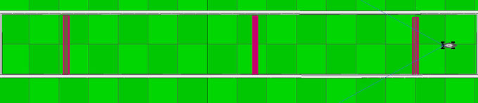

# lidar-racer

An autonomous car that drives a race track using nothing but a 32-ray lidar,
a text protocol, and about a thousand lines of C.

The car has no map, no odometry, no camera and no knowledge of its own
dimensions. Thirty-two distances in a 60° cone in front of it, updated every
cycle, are the entire input. Two numbers — steering angle and engine power —
are the entire output. Everything between the two is in this repository.



*A full run, cleared in 66 control cycles. The pink bars are checkpoints; the
car has never seen this track before and holds no map of it.*

```
   lidar (32 rays, 60°)              decision                actuators
  ╲   ╲   │   ╱   ╱
   ╲   ╲  │  ╱   ╱          clean → bubble → gap        WHEELS_DIR  −1…1
    ╲   ╲ │ ╱   ╱      ──▶       ↓            ──▶       CAR_FORWARD  0…1
     ╲   ╲│╱   ╱                PD + throttle curve
      ┌───────┐
      │  car  │
      └───────┘
```

---

## Table of contents

| Document | What it covers |
|---|---|
| [docs/01-protocol.md](docs/01-protocol.md) | The wire protocol, and the three traps in it |
| [docs/02-architecture.md](docs/02-architecture.md) | How the code is laid out and why |
| [docs/03-perception.md](docs/03-perception.md) | From 32 numbers to "drive that way" |
| [docs/04-control.md](docs/04-control.md) | The steering and throttle laws, and the PD controller |
| [docs/05-simulator-setup.md](docs/05-simulator-setup.md) | Installing CoppeliaSim and the API, running a race |
| [docs/06-tuning.md](docs/06-tuning.md) | Every knob, what it does, how to find a good value |
| [docs/07-docker.md](docs/07-docker.md) | Running it in a container |
| [docs/08-audit.md](docs/08-audit.md) | Why it is not fast yet, measured, and what would fix it |

---

## Quick start

```bash
git clone <this repository>
cd lidar-racer
make                # builds ./ai
make test           # 1015 assertions, no simulator required
```

`make` is not optional before a race: `scripts/run.sh` needs `./ai` to exist,
and `make fclean` removes it.

To actually drive, you also need the simulator and the API binaries — see
[docs/05-simulator-setup.md](docs/05-simulator-setup.md). `./ai` is an
ordinary binary speaking the protocol on stdin and stdout, so it runs under
the launcher shipped with the API, unchanged:

```bash
cp ai /path/to/n4s_package/
cd /path/to/n4s_package
./pipes.sh                          # open a scene in CoppeliaSim first
AI_OPTS="--verbose" ./pipes.sh      # pipes.sh takes no arguments; this does
```

There is also a wrapper that starts the simulator, loads a scene and races it
in one command — optional, and described in the setup chapter:

```bash
scripts/simulate.sh bootstrap_track -- --verbose
```

Real output from a cleared track:

```
[00030] RACING    fwd=  3010 near=   850 gap=yes@-004.7 wheels=-0.187 thr=0.493 rev=0.000 laps=0
[00031] RACING    fwd=  3007 near=   650 gap=yes@+006.6 wheels=+0.123 thr=0.513 rev=0.000 laps=0
[00032] RACING    fwd=  2923 near=   612 gap=yes@+008.4 wheels=+0.123 thr=0.501 rev=0.000 laps=0
        >>> checkpoint (laps=0)
[00039] RACING    fwd=   975 near=   875 gap=yes@+008.4 wheels=+0.292 thr=0.174 rev=0.000 laps=0
        >>> TRACK CLEARED (laps=0)
```

---

## How it drives

The method is **follow the gap**, the same family of algorithm used in
small-scale autonomous racing. Each cycle:

1. **Clean the scan.** Faulty readings collapse to "obstacle right here", not
   to "open road" — the failure mode has to be braking, never accelerating.
2. **Draw a bubble.** Erase every ray within a safety radius of the closest
   obstacle. Closer obstacles produce wider bubbles, so the car naturally
   swings wide around a corner it is about to clip.
3. **Find the widest gap.** The longest surviving run of rays that reach far
   enough to be drivable. Aim at the middle of its deepest plateau rather than
   at the single furthest ray, which would flicker between neighbours and make
   the car wag down the straights.
4. **Steer.** A PD controller on the heading error, plus a light corridor
   centring term, rate limited so the wheels never snap.
5. **Set the power.** A distance-to-throttle curve, reduced in proportion to
   how hard the car is turning.

A small state machine sits on top: `RACING` → `ESCAPE` whenever the car stops
making progress, for any reason; → `HALTING` once escaping has failed enough
times to count as a genuine dead end.

`ESCAPE` is a **three-point turn**, not a reverse, and the distinction is the
whole point. Backing up in a straight line translates the car without rotating
it, so it drives forward into the same wall again — measured across the real
runs, 128 of 294 reversing cycles applied exactly zero steering and did
precisely that. A car with Ackermann steering cannot turn on the spot, so the
manoeuvre alternates: back up with the wheels one way, pull forward with them
the other. Both phases rotate it the same direction.

Halting backs off until it has a metre of clearance before ending the
simulation — stopping with the bumper against the wall is a failed run even
though the car did stop — but it is bounded. Reversing is blind, and a car
that keeps backing out of a dead end is just driving the track backwards.

---

## Design notes worth reading even if you never run it

Each of these is a specific decision with a specific reason, documented at the
place in the code where it applies.

**The response parser does not split on `:`.** `ADDITIONAL_INFO` is free text
that contains colons of its own:

```
1:OK:No errors so far:-25.1:First CP Cleared: [0][88s 26029102ns]
```

Splitting on `:` and reading fixed indices strands the timestamp in a separate
field, and code looking for the checkpoint message finds nothing — so the car
never learns it is making progress and never learns the race has ended. The
parser consumes numeric fields greedily and treats everything after them as
one opaque string. There is a regression test on that exact line.

**Nothing writes to stdout through stdio.** The processes form a ring, so a
buffered `printf` sits in memory while we block reading the answer to a
command that was never sent. Both sides wait forever, and the symptom is a
program that simply does nothing. Every byte goes out through `write(2)`.

**Every cycle costs exactly four round trips.** Always the same four, even
when one is redundant. A constant loop rate is what lets the derivative term
of the steering controller be a plain difference between consecutive errors
instead of a division by a jittery measured timestep. It is also the single
biggest speed-up available: re-reading the car's maximum and minimum speed
every cycle, as is tempting, spends half the loop waiting for two constants.

**One flag fixes both left/right conventions.** Whether lidar ray 0 points
left, and whether a positive steering value turns right, are both
undocumented. That looks like four cases but is really two — mirroring the
perception and mirroring the action cancel out, so only the combination is
observable. `--mirror` covers it, and it defaults to on because that is what
the simulator turned out to need: with it off, the car steers into the first
corner within three cycles, every time.

**Every threshold is a command line option.** Tuning a car by editing
constants and rebuilding turns a ten-minute job into an evening. The option
table also generates `--help` and the telemetry dump, so they cannot drift
apart.

**The car is never idle.** Every cycle it either commands forward motion or is
recovering. This sounds obvious and is the rule the first version broke: with
one threshold to cut the throttle and a lower one to start reversing, there is
a band between them where the car does neither. It parked itself in that band,
300mm from a wall, and waited twenty cycles for a timer — with nothing in the
telemetry explaining why, because no single rule was being violated.

**It never drives without a gap, and never stops when it has one.** Two halves
of the same idea. Creeping forward when the gap search found nothing is
driving blind. But stopping dead when a gap *is* visible is just as wrong: a
stationary car with its wheels turned goes nowhere, so cutting the throttle
near a wall prevents the exact manoeuvre needed to get round it. Below the
braking distance with a gap in sight, the car crawls.

**Speed is bounded by the loop rate, not the engine.** At full power the car
covered about 1.1m per control cycle, and the loop runs at roughly two cycles
per second against a live simulator — so it went from 3010mm of clear road to
396mm in six cycles, with the controller doing everything correctly the whole
way down. `--throttle-max` defaults to 0.55 for that reason.

---

## Results

Measured against CoppeliaSim 4.1 with the N4S API, ODE physics, default
settings, at roughly two control cycles per second:

| Scene | Checkpoints | Cleared | Behaviour |
|---|---|---|---|
| `bootstrap_track` | 3 | **8/8** | median 40 cycles |
| `criss_cross` | 3 | 0/4 | reaches 2 of 3, then stops at the same spot every run |
| `diamond_bonus` | 3 | 1/6 | reaches 2 of 3 |
| `track_3` | 12 | 0/2 | 1 checkpoint, drives 200+ cycles without ever getting stuck |
| `track_4` | 12 | 0/2 | 1 checkpoint, same |
| `8_bonus` | 11 | 0/3 | 0–1 checkpoints, very tight corridors |
| `track_1` | — | — | the scene will not load into CoppeliaSim at all |
| `track_2` | — | — | the scene loads, its lidar returns only zeros |

The two broken scenes are broken independently of this code, and `track_1` is
the one the original project instructions tell you to open first.

**Two distinct failure modes, and they want different fixes.** On the short
tracks the car reaches two of three checkpoints and then meets one specific
place it cannot get past — reproducibly, the same place every run, ending in a
clean stop. That is a manoeuvring problem. On the long tracks it never gets
stuck at all: it drives continuously for hundreds of cycles and simply does
not get round in the time available. That is a speed problem.

Follow-the-gap drives down the middle of the corridor rather than along a
racing line, and the control loop only runs at about two cycles per second —
roughly one decision per metre travelled. [docs/08-audit.md](docs/08-audit.md)
measures where that budget goes and what would buy the most back.

Every default was set from a measurement, not a guess.
[docs/06-tuning.md](docs/06-tuning.md) records which measurement and why, and
`scripts/benchmark.sh` is how any change to them should be judged — single
runs mislead badly here.

## Testing

The driving code is deliberately split so that the parts that can be tested
without a simulator, are:

```
$ make test
util
response
perception
control

1015 checks, 0 failed
OK
```

Parsing, scan geometry, the safety bubble, gap selection, both control laws
and every state machine transition are covered by assertions on hand-written
inputs. A car that understeers in a 3D simulator tells you nothing about which
of five stages is wrong; a failing assertion tells you exactly.

Several of these tests are regressions written *after* a real run exposed
something the unit tests could not have caught on their own — the idle band
between the braking and reversing thresholds, driving forward with no gap, the
halting loop that never settles. Each one names the failure it prevents.

What the tests still do **not** cover is whether the resulting car is fast, or
whether it completes a given track. That needs the simulator. See
[Results](#results).

---

## Requirements

- A C99 compiler and `make` (that is the whole build dependency list)
- For driving: CoppeliaSim and the `n4s` API binaries — see
  [docs/05-simulator-setup.md](docs/05-simulator-setup.md)
- Optionally Docker — see [docs/07-docker.md](docs/07-docker.md)

## Licence

MIT. See [LICENSE](LICENSE).

The simulator, the scenes and the `n4s` API binaries are not part of this
repository and are not covered by that licence.
