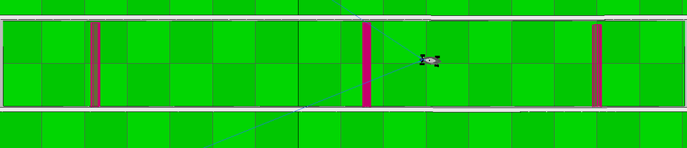

# 3. Perception

Everything the car knows about the world is 32 numbers, refreshed every cycle.
This chapter is about turning them into a direction.

## The sensor

A lidar sweeps a laser across a cone and reports, for each direction it
sampled, how far away the first thing it hit was.

- **32 rays**, evenly spaced
- **60° field of view**, centred on the car's nose
- **millimetres**, saturated at **3010 mm**

That saturation matters. A ray reporting 3010 does not mean "there is a wall
at 3010 mm". It means "nothing within reach" — the sensor gave up looking. You
cannot distinguish a wall at exactly 3.01 m from open sky.

60° is narrow. The car is blind to everything beside and behind it. It cannot
see the wall it is currently scraping if that wall is at 40° off the nose.
Every design decision downstream is shaped by that limitation.

### Where each ray points

The 32 rays sample the **centres** of 32 equal slices, not the boundaries:

```
       ray 0                ray 15  ray 16                ray 31
  −29.06°                  −0.94°   +0.94°                 +29.06°
        ╲    ╲    ╲    ╲    │    │    ╱    ╱    ╱    ╱
         ╲    ╲    ╲    ╲   │    │   ╱    ╱    ╱    ╱
          ╲    ╲    ╲    ╲  │    │  ╱    ╱    ╱    ╱
                        ┌───────────┐
                        │    car    │
                        └───────────┘
   |←───────────────── 60° total ─────────────────→|
```

Slice width is 60/32 = 1.875°, so ray *i* points at

```
angle(i) = −30 + (i + 0.5) × 1.875
```

The `+ 0.5` is not a rounding detail. Leaving it out puts ray 0 at exactly
−30° and ray 31 at +28.125°, which makes the cone asymmetric and biases every
steering command the car ever issues towards one side. There is no straight
line the car can drive; it drifts, and you spend an afternoon tuning gains to
compensate for an arithmetic error.

### Which end is the left?

The documentation does not say whether ray 0 points left or right. Nor does it
say whether a positive `WHEELS_DIR` steers left or right.

That is four combinations — except it is really two. Mirroring the perception
and mirroring the action cancel each other out:

| Perception | Action | Result |
|---|---|---|
| correct | correct | drives correctly |
| mirrored | correct | drives into walls |
| correct | mirrored | drives into walls |
| mirrored | mirrored | drives correctly |

Only the combination is observable, so one flag covers it. `--mirror` reverses
the scan array; every other function in the codebase then assumes "index 0 is
on the left, positive steers right".

**The experiment:** start a race and watch the first corner. If the car turns
consistently *into* the wall it should be avoiding, flip the flag. It takes
one run to settle, and it stays settled.

**The measurement.** On the N4S simulator the convention turns out to be the
mirrored one, so `--mirror` defaults to **on**. This was not guessed. With it
off, the car steers into the first corner within three cycles:

```
[00001] RACING  fwd=3010 near= 725 gap=yes@+000.9 wheels=+0.068 thr=0.529
[00002] RACING  fwd=3007 near= 688 gap=yes@+006.6 wheels=+0.318 thr=0.454
[00003] RACING  fwd= 500 near= 283 gap=yes@+027.2 wheels=+0.568 thr=0.100
[00004] ESCAPE ... (the recovery manoeuvre, cycle after cycle)
```

With it on, from the same starting position, it drives:

```
[00001] RACING  fwd=2923 near= 725 gap=yes@-002.8 wheels=-0.187 thr=0.482
[00005] RACING  fwd=3010 near= 850 gap=yes@-004.7 wheels=-0.187 thr=0.493
[00009] RACING  fwd=3010 near= 688 gap=yes@+006.6 wheels=+0.123 thr=0.513
```

The signature to look for is `near` collapsing while the steering keeps
pushing in the same direction: that is a car steering confidently at what it
believes is open space. Set `--mirror=0` if your setup is wired the other way.



*What the 60° cone has to work with: a corridor a little over a metre wide,
walls it cannot see once they are beside it, and checkpoints it only learns
about after crossing them.*

## Stage 1 — cleaning

```c
scan_build(&scan, raw, &cfg);
```

Three things happen, in order.

**Sanitising.** Any reading that is negative, zero, or not a finite number is a
sensor fault. What you put in its place is the most consequential decision in
the perception code, because the two options are not symmetric.

Substituting the *maximum* range — treating a dead ray as open space — is one
line, looks perfectly reasonable, and puts the car into a wall the first time
the sensor hiccups. The simulator returns all-zero scans before the scene is
running; an optimistic substitution launches the car at full throttle at
something it cannot see.

**Ambiguity resolves towards braking.** Always.

But "obstacle right here" is not right either, and this took a real run to
notice. An *isolated* dead ray, with healthy neighbours on both sides, is a
dropout — not a wall. Substituting the floor distance turns it into a phantom
obstacle one millimetre away, which inflates the safety bubble to its maximum
for that cycle and can erase an opening the car could have driven through.
Measured on one track: 9 of 254 cycles.

So the rule has two halves:

- an isolated dropout is **interpolated** from its neighbours
- a *run* of dead rays, with nothing healthy to interpolate from, collapses to
  the floor — the pessimistic answer

A scan where *every* ray is faulty is not a car in a sealed box, it is a dead
sensor. [`main.c`](../src/main.c) detects that case separately, skips the
cycle, and says so on stderr — braking on it every cycle in silence is
indistinguishable from a hang.

**Clamping** to `[floor, 3010]` — nothing outside the sensor's physical range
reaches the control code.

**Smoothing.** A centred moving average over `--smooth` rays (3 by default):

```
raw:      1000  1000  1300  1000  1000
smoothed: 1000  1100  1100  1100  1000
```

This trades angular resolution for stability. A single noisy ray no longer
swings the steering. The window shrinks at the edges rather than wrapping,
because ray 0 and ray 31 are not neighbours in the real world — they are 60°
apart, on opposite sides of the car.

Set `--smooth=1` to disable it, which is what the tests do so that assertions
refer to the numbers that went in.

### Summary distances

`scan_build` also computes what the throttle law needs:

- `forward_mm` — the **minimum** over the five central rays
- `left_mm`, `right_mm` — the means over the outer thirds
- `closest_mm`, `closest_index` — the nearest obstacle anywhere in the cone

`forward_mm` is a minimum, not a mean, and that is deliberate. Averaging five
rays where one reads 400 mm and four read 3000 mm gives 2480 mm — a
comfortable-looking number that says "accelerate". The 400 mm is a post, and
the car drives into it at full power. Minimum, always, for anything that feeds
a braking decision.

## Stage 2 — the safety bubble

```c
scan_apply_bubble(&scan, &cfg);
```

Find the closest obstacle. Erase every ray pointing within a safety radius of
it — set them to zero, so the gap search cannot possibly choose them.

```
before:  ▓▓▓▓▓▓░░░░░░████████████░░░░░░▓▓     ← ░ near, ▓ far, █ closest
after:   ▓▓▓▓▓▓░░________________░░░░░░▓▓     ← erased
```

The radius is angular, and derived from the distance:

```c
half_angle = atan2(bubble_mm, distance_to_closest)
```

The geometry is the point. An object 260 mm wide seen from 3 m subtends 5°; the
same object at 500 mm subtends 27°. **The closer the obstacle, the wider the
slice the car refuses to aim at.** That single line is what makes the car swing
wide around a corner it is about to clip, without anybody writing a rule that
says so.

### Why it is capped

Exact geometry becomes unusable at close range. At 500 mm the bubble covers
27° each side — 54° of a 60° cone. The car would find no gap in a corridor it
fits through perfectly well, declare a dead end in the middle of a hairpin,
and stop.

So the half-angle is capped at a quarter of the field of view (15°), which
guarantees at least half the cone survives:

```c
half_angle = fmin(half_angle, N4S_LIDAR_FOV_DEG * 0.25);
```

This is the honest trade in the whole algorithm: a geometrically correct
bubble is too conservative to drive with, and the cap is where correctness is
traded for the ability to get round a corner. It is a tuning parameter
disguised as a constant, and it is documented as such at the line where it
applies.

## Stage 3 — finding the gap

```c
scan_find_gap(&scan, &cfg, &gap);
```

Two steps.

**Find the widest opening.** The longest contiguous run of rays reaching at
least `--gap-threshold` (1200 mm by default). Longest, not deepest: a wide
opening the car fits through beats a narrow one that happens to look further.

**Aim inside it.** Not at the single furthest ray — at the middle of the
deepest *plateau*, the longest stretch of rays within 250 mm of the gap's
maximum.

The difference shows up on a straight. Down an open road, thirty rays report
distances within a few millimetres of each other, and which one is nominally
the largest is decided by sensor noise. Aiming at it makes the target jump
from one side of the cone to the other every cycle, and the car wags its way
down the straight. Aiming at the plateau centre gives the same answer every
cycle. There is a test for exactly this
([`test_target_is_stable_on_a_plateau`](../tests/test_perception.c)).

**No gap at all** — every ray below the threshold — is a legitimate output. It
is what a dead end looks like, and the state machine, not the perception code,
decides what to do about it.

## What this method cannot do

Follow-the-gap is reactive. It has no memory, no map, and no plan. It cannot:

- take a **racing line** — it drives down the middle of the corridor, not the
  fast way round the corner
- avoid a **trap**: a wide opening that leads nowhere still looks like the
  best gap
- recognise it has **been here before**

For a track with walls and no moving obstacles, it is enough, and it is
roughly a hundred lines. Anything better requires state: an occupancy map, a
planned path, or a learned policy. That is a different project, and it starts
by keeping this one as the baseline to beat.

Next: [4. Control](04-control.md)
