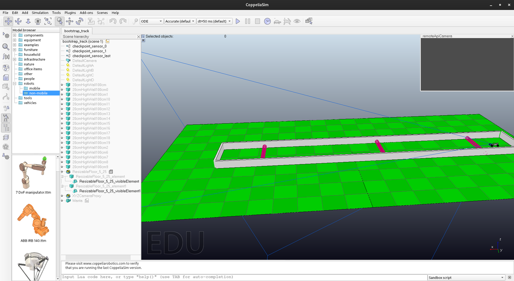

# 5. Simulator setup

The AI is one of four processes. This chapter gets the other three running.

## What you need

| Piece | What it is | Where it comes from |
|---|---|---|
| `ai` | This repository | `make` |
| `n4s` | The API: text protocol ⇄ simulator | Not in this repository — see below |
| `n4s_buffer` | Unbuffered pipe forwarder | Ships with `n4s` |
| CoppeliaSim | The 3D physics simulator | coppeliarobotics.com |
| `*.ttt` scenes | Track and car | Ships with `n4s` |

**`n4s`, `n4s_buffer` and the scenes are not part of this repository.** They
are third-party binaries and assets that are not ours to redistribute. Put
them next to `ai`, or set `N4S` and `BUFFER`
keep them.

## Installing CoppeliaSim

The scenes were authored for **CoppeliaSim Edu V4.1.0, Ubuntu 20.04 build**,
available from the "previous versions" page at coppeliarobotics.com. Download,
extract, and launch:

```bash
tar -xf CoppeliaSim_Edu_V4_1_0_Ubuntu20_04.tar.xz
cd CoppeliaSim_Edu_V4_1_0_Ubuntu20_04
./coppeliaSim.sh
```

The archive is about 150 MB and unpacks to 455 MB. On a current Fedora it
needed no extra packages at all — every library it wants (`libGL`, `libX11`,
the `xcb` family, `libxkbcommon-x11`, `fontconfig`, `nss`) was already
present. Check before you go hunting:

```bash
LD_LIBRARY_PATH=$PWD ldd coppeliaSim | grep "not found"
```

Silence means you are fine. Two plugins (`BlueZero`, `Image`) fail to load and
neither matters here.

**Never commit it.** An earlier incarnation of this project committed the
entire install and had to rewrite history to remove it. `.gitignore` already
covers `CoppeliaSim*/` and `*.ttt`.

### Startup dialogs will hang it

Out of the box, `system/usrset.txt` has `suppressStartupDialogs = false`.
CoppeliaSim then blocks on a modal dialog during startup — the remote API port
opens and accepts connections, but every request returns an error, and the
main thread sits in a futex forever. It looks like a crash and is not one.

Set these in `system/usrset.txt` before the first run:

```
suppressStartupDialogs = true
doNotShowUpdateCheckMessage = true
doNotShowCrashRecoveryMessage = true
```



*CoppeliaSim with `bootstrap_track` open. Leave the simulation stopped — the
AI starts it. The physics engine selector reads ODE in the toolbar.*

## The standard workflow

This is the procedure the project brief describes, and it works unchanged.

```bash
make                                     # produces ./ai
cp ai /path/to/n4s_package/              # next to n4s, n4s_buffer, pipes.sh
```

Then, in CoppeliaSim: open a track scene, check `Simulation → Using the ODE
physics engine`, and leave the simulation **stopped** — the AI starts it.

```bash
cd /path/to/n4s_package
./pipes.sh
```

That is all. `pipes.sh` is the launcher shipped with the API; nothing in this
repository replaces it, and `./ai` is an ordinary binary that reads the
protocol on stdin and writes it on stdout.

### Telemetry through pipes.sh

`pipes.sh` runs the binary with no arguments and offers no way to add any. The
current AI accepts one option, `--verbose`, so the useful invocation is:

```bash
AI_OPTS="--verbose" ./pipes.sh
```

The simplified car has no tuning knobs on the command line. Its two threshold
tables live in [`src/car.c`](../src/car.c); change a number there and rebuild.

Verified end to end: `AI_OPTS="--verbose" ./pipes.sh` cleared
`bootstrap_track`.

## The same thing in one command

Everything below is optional. [`scripts/simulate.sh`](../scripts/simulate.sh)
does the sequence above without the manual steps: it stops any simulator
already running, starts a new one, waits for its API, loads and checks the
scene, and races it. Useful for repeated runs and for headless work; the
standard workflow remains the reference.

```bash
export COPPELIASIM_ROOT=~/opt/CoppeliaSim_Edu_V4_1_0_Ubuntu20_04

scripts/simulate.sh bootstrap_track                 # headless, recommended
scripts/simulate.sh --gui criss_cross               # with the window, to watch
scripts/simulate.sh track_3 -- --verbose            # options go to the AI
```

Scenes are looked up by name in `$SCENE_DIR` (default `~/opt/n4s-scenes`), or
you can give a path. An unknown name lists what is available.

It exists because the manual sequence has four ways to go subtly wrong, and
three of them fail silently:

- a second CoppeliaSim left running, so the two fight over port 19997 and the
  API talks to whichever won — not necessarily the one holding your scene
- launching from the wrong directory
- forgetting that headless ignores the scene argument, and racing an empty
  scene
- racing a scene whose lidar does not work

There is a fourth, subtler one the script handles: a killed instance keeps its
listening socket for a moment, so "is the port up?" answers yes, you connect
to the corpse, and the check two seconds later fails. The script waits for the
port to *close* before starting the replacement, and then requires it to
answer twice before believing it.

The rest of this chapter is what the script does, for when you want to do it
by hand or something goes wrong.

## Loading a scene

The normal way, with the window open:

```bash
./coppeliaSim.sh ~/n4s-scenes/bootstrap_track.ttt
```

or launch it bare and use `File → Open scene…`. Either works.

Two things will waste your afternoon if you do not know them.

**The command line argument does not survive a path with spaces.**
`coppeliaSim.sh` does not quote it, so a scene under `~/my projects/` arrives
as two arguments and is silently ignored — you get an empty scene and the API
reports `5:KO:SimComponent Loading Failure`. Keep the scenes somewhere without
spaces.

**A corrupt scene hangs the whole application.** Handing it `track_1.ttt`
(see below) does not produce an error dialog. CoppeliaSim opens its remote API
port, accepts connections, and then blocks forever with its main thread parked
on a futex, answering every single request with an error. It looks exactly
like a broken installation, and it is not — it is one bad file. If the
application appears to start but nothing responds, try a different scene
before you start reinstalling libraries.

### Headless — and why it is the recommended mode

`-h` runs without a window. It is quicker, and it is the mode this project is
verified against: `bootstrap_track` clears in 8–11 cycles, run after run.

The windowed simulator is slower per decision — the car covers more ground
between two commands — but the simple threshold algorithm is much less
sensitive to that than the old controller was. Use headless when you want a
result you can compare against another, and use the window when you want to
watch the car drive.

Two things that are known to matter and are worth ruling out first: more than
one CoppeliaSim instance running at once (they fight over port 19997, and
`ss -ltnp | grep 19997` tells you which one won), and a run killed before it
could send `STOP_SIMULATION`.

The catch: **headless ignores the scene argument entirely.** Load the scene
over the remote API instead. [`scripts/load_scene.py`](../scripts/load_scene.py)
does that, selects the ODE engine, and checks the scene actually contains the
objects the API drives:

```bash
export COPPELIASIM_ROOT=~/opt/CoppeliaSim_Edu_V4_1_0_Ubuntu20_04
scripts/load_scene.py ~/n4s-scenes/bootstrap_track.ttt
```
```
scene       bootstrap_track.ttt
objects     258
checkpoints 3
engine      ode

Ready. Leave the simulation stopped; the AI starts it.
```

It refuses a path containing a space and reports a scene that will not load,
rather than leaving you to work out why the API says `SimComponent Loading
Failure`. Under the hood it is just the bindings CoppeliaSim ships in
`programming/remoteApiBindings/python/`:

```python
import sim
cid = sim.simxStart('127.0.0.1', 19997, True, True, 5000, 5)
sim.simxLoadScene(cid, '/home/you/n4s-scenes/bootstrap_track.ttt', 0,
                  sim.simx_opmode_blocking)
sim.simxSetIntegerParameter(cid, sim.sim_intparam_dynamic_engine, 1,
                            sim.simx_opmode_blocking)   # 1 = ODE
```

### Check the physics engine

```
Simulation → Using the ODE physics engine
```

The car's suspension and tyre friction were built for ODE; under another
engine you end up tuning the controller to compensate for the wrong physics.
The supplied scenes are already saved with ODE selected — worth confirming
rather than assuming.

### Not every supplied scene works

Of the eight scenes shipped with the API package, two are unusable:

| Scene | State |
|---|---|
| `bootstrap_track` | works — 3 checkpoints, the one to tune against |
| `criss_cross` | works — 3 checkpoints, tight |
| `diamond_bonus` | works — 3 checkpoints |
| `track_3`, `track_4` | work — 12 checkpoints each |
| `8_bonus` | works — 11 checkpoints |
| **`track_1`** | **will not load, and hangs the application if passed on the command line** |
| **`track_2`** | **loads, but its lidar returns nothing but zeros** |

`track_1` is the one the original instructions tell you to open first, which
is worth knowing before concluding that your AI is broken. Start with
`bootstrap_track`.

Leave CoppeliaSim running with the scene loaded. Do **not** press its own play
button: `START_SIMULATION`, sent by the AI, does that.

## Running a race

```bash
make
./pipe.sh -- --verbose
```

The script builds the same ring as `pipes.sh` and starts driving. `--verbose`
prints one telemetry line per cycle on stderr:

```
[00001] fwd=  3010 left=   975 right=  1050 wheels=-0.005 thr=1.000
```

| Field | Meaning |
|---|---|
| `[00001]` | Cycle number |
| `fwd` | Distance straight ahead, mm |
| `left` / `right` | Edge-ray distances used to choose the steering sign |
| `wheels` | `WHEELS_DIR` sent |
| `thr` | `CAR_FORWARD` sent |

Ctrl-C stops the car and ends the simulation cleanly.

## Why the pipeline is a ring

```
    ai ──stdout──▶ buffer ──▶ n4s ──▶ buffer ──┐
     ▲                                          │
     └──────────────── FIFO ────────────────────┘
```

A shell pipeline can only express a line, and we need a loop: the AI's output
must reach the API, and the API's output must come back to the AI's input. The
return path is a named pipe (FIFO), created by
[`pipe.sh`](../pipe.sh) and removed when it exits.

The two `buffer` processes are there because the API writes through buffered
stdio. Between pipes that buffer is 4 KB, so its answer would sit in memory
while the AI waits for it and it waits for the next command — a deadlock with
no error message. `n4s_buffer` forwards byte by byte and breaks it. See
[protocol, trap 2](01-protocol.md#2-buffered-stdout-deadlocks-the-pipeline)
for why the AI never uses `printf` on stdout either.

`pipe.sh` creates its FIFO with `mktemp -u`, so two runs on one machine do not
fight over the same pipe.

## Troubleshooting

| Symptom | Cause |
|---|---|
| `6:KO:Network operation Failure` | CoppeliaSim is not running. The API connects to `127.0.0.1:19997` |
| `0:KO:Simulation has not been launched` | Scene loaded but the simulation was never started |
| `22:KO:Scene must contain at least 3 CPs` | Wrong scene, or an edited one that lost its checkpoints |
| `25:KO:Failed to load Map` | Scene not compatible with this build of CoppeliaSim |
| Nothing happens, no output, no error | Buffering deadlock — something is writing to stdout through stdio |
| CoppeliaSim starts but every API call errors | A corrupt scene, or a startup dialog. Try another scene first |
| Car steers into walls, consistently | The lidar ray order does not match the simulator; swap the left/right ray indices in `src/car.c` |
| Car crawls, or does not move at all | A command outside its valid range is being rejected. Run with `N4S_DEBUG=1` to see the API's replies |
| Car reaches a corner and stops | No scene has this problem with the threshold controller; check the lidar is returning real distances |

To check the protocol without any of the above, talk to the API by hand:

```console
$ ./n4s
get_car_speed_max
1:OK:No errors so far:50.3:No further info
```

`GET_CAR_SPEED_MAX` and `GET_CAR_SPEED_MIN` answer even with no simulator
attached, so a reply here proves the API binary itself is fine and narrows the
problem to CoppeliaSim.
